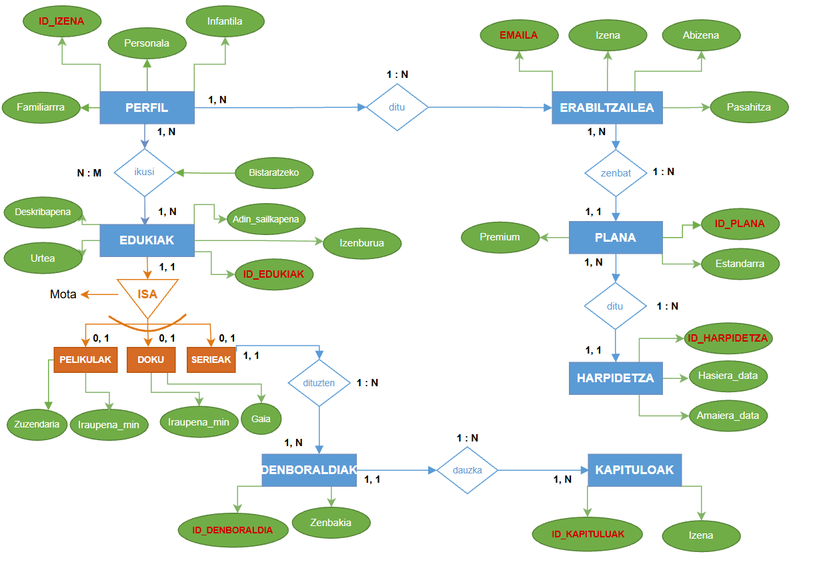

### 1. E/R sortu:
---
Erronka honetan, streaming-plataforma baten datu-basea diseinatu dugu, erabiltzaileak, profilak, edukiak eta harpidetzak modu antolatuan kudeatzeko. Horretarako, entitate-erlazio diagrama (ER diagrama) sortu dugu, sistemaren elementu nagusiak eta haien arteko erlazioak irudikatzeko.

Lehenik eta behin, erabiltzaileak eta profilak definitu ditugu. Erabiltzaile bakoitzak bere datu pertsonalak ditu, hala nola helbide elektronikoa, izena, abizena eta pasahitza. Horrez gain, profilak sortu eta kudea daitezke, profil bakoitzak bere identifikatzailearekin eta informazio pertsonalarekin.

Bestalde, plataformak eskaintzen dituen edukiak ere definitu ditugu. Eduki bakoitzak identifikatzaile bat, izenburua, adin-sailkapena, deskribapena eta urtea ditu. Edukiak hiru motatan banatzen dira: pelikulak, dokumentalak eta serieak. Mota bakoitzak bere ezaugarri espezifikoak ditu. Adibidez, pelikulak eta dokumentalak iraupenaren arabera deskribatzen dira, eta dokumentalek gai bat ere izan dezakete. Serieak, berriz, denboraldietan banatzen dira, eta denboraldi bakoitzak hainbat kapitulu izan ditzake.

Horrez gain, erabiltzaileek harpidetza-plan desberdinak izan ditzakete. Bi plan mota definitu ditugu: estandarra eta premiuma. Plan bakoitzak bere ezaugarriak ditu, eta harpidetzen bidez erabiltzaileek plataformako zerbitzuetara sarbidea dute. Harpidetzek hasiera- eta amaiera-datak dituzte, eta horien bidez harpidetzaren iraupena kontrola daiteke.

Azkenik, entitateen arteko erlazioak eta kardinalitateak zehaztu ditugu, sistema osoaren funtzionamendua behar bezala irudikatzeko. Horrela, erabiltzaileen, profilen, edukien eta harpidetzen arteko loturak argi geratzen dira, eta datu-basearen egitura modu logiko eta antolatuan definitzen da.

Ondorioz, ER diagramaren helburua streaming-plataforma baten informazioa modu eraginkorrean antolatzea da, datuak behar bezala gordetzeko, erlazionatzeko eta etorkizunean kontsultatu eta kudeatu ahal izateko.

  

### 2. Modu erlazionala egin:
---
ER diagrama egin ondoren, zerrenda erlazionala sortu dugu, entitateak eta haien arteko erlazioak taula bihurtuz, atributuak zehaztuz eta gako primarioak (PK) eta gako arrotzak (FK) identifikatuz.

- **HARPIDETZA** (ID_HARPIDETZA, Hasiera_data, Amaiera_data)
- **PLANA** (ID_PLANA, ID_HARPIDETZA, Estandarra, Premium)
- **ERABILTZAILEA** (EMAILA, ID_PLANA, Izena, Abizena, Pasahitza)
- **PERFIL** (ID_IZENA, EMAILA, Pertsonala, Familiarra, Infantila)
- **IKUSI** (ID_IZENA, ID_EDUKIAK, Bistaratzea)
- **EDUKIAK** (ID_EDUKIAK, Adin_sailkapena, Izenburua, Urtea, Deskribapena, Mota)
- **PELIKULAK** (Zuzendaria, Iraupena_min)

  - id: EDUKIKO FK (id)

- **DOKU** (Gaia, Iraupena_min)

  - id: EDUKIKO FK (id)

- **SERIEAK**

  - id: EDUKIKO FK (id)

- **DENBORALDIAK** (ID_DENBORALDIA, ID_EDUKIAK, Zenbakia)
- **KAPITULUAK** (ID_KAPITULUA, ID_DENBORALDIA, Izena)

### 3. Datu basea normalizatu (1F-2F-3F):
---

Ondoren, datu-basearen normalizazioa landu dugu, hiru forma normalak aplikatuz. Lehen forma normalean (1F), atributu bakoitzak balio bakarra izatea eta datuak behar bezala antolatuta egotea ziurtatu dugu. Bigarren forma normalean (2F), menpekotasun partzialak aztertu ditugu, atributu bakoitza gako primario osoaren menpe egon dadin. Azkenik, hirugarren forma normalean (3F), menpekotasun iragankorrak aztertu ditugu, datuen errepikapenak eta eguneratze-arazoak saihesteko.

Prozesu horri esker, datu-basearen egitura koherenteagoa eta eraginkorragoa lortu nahi izan dugu, informazioa modu egokian gordetzeko, erlazionatzeko, kontsultatzeko eta eguneratzeko. Horrela, streaming-plataformaren erabiltzaileak, profilak, edukiak, planak eta harpidetzak modu antolatuan kudeatu ahal izango dira.
