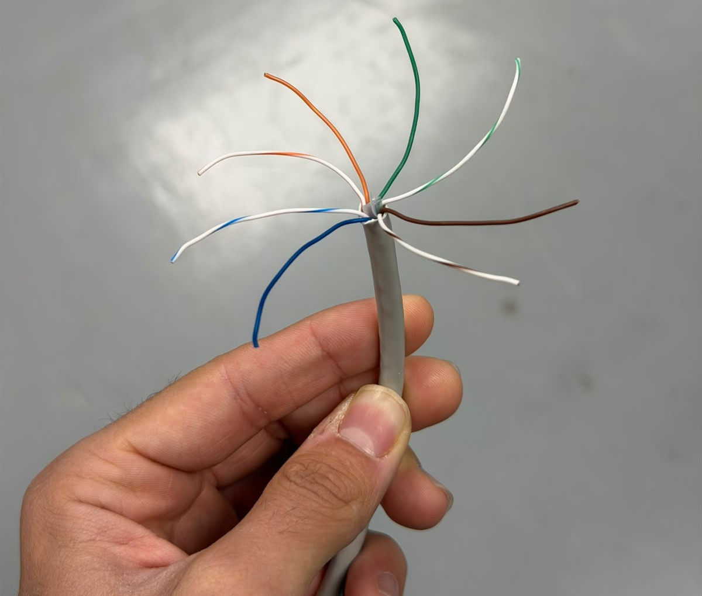
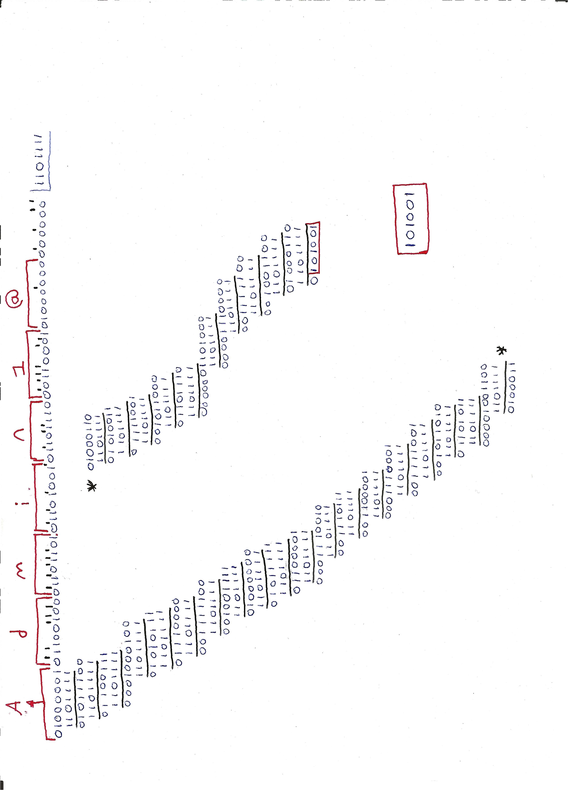
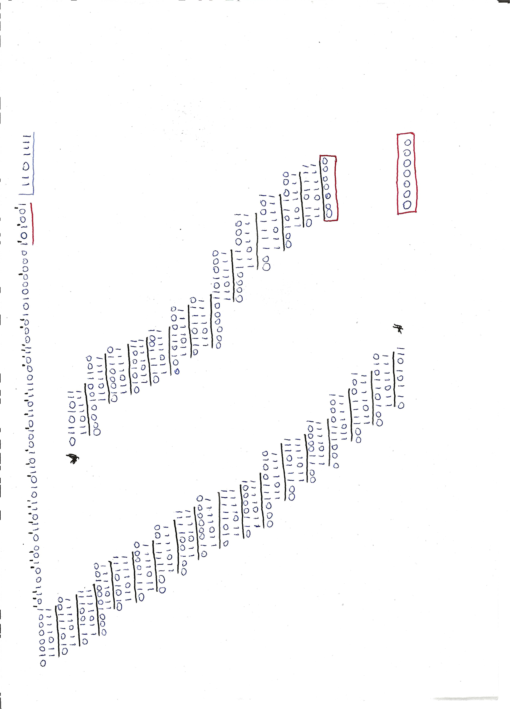

Erronka honetan, OSI ereduaren lehen bi mailak landu ditugu: 1. maila fisikoa eta 2. maila, datu-loturakoa. Sare-konexioa osatu dugu, datuak hainbat formatutan kodetu ditugu eta webgunea hari gabeko gailu batetik probatu dugu.

Lehenik, gure taldeak egindako sare-kableak patch panelera konektatu ditugu, eta handik switchera. Ondoren, sisteman sartzeko pasahitzetako bat ASCII kode bihurtu dugu. Datu horiei CRC-6-GSM errore-kontrol kodea gehitu diegu, polinomio hau erabiliz: \(x^6+x^5+x^3+x^2+x+1\).

Datuak prestatu ondoren, dagokion modulazioa aukeratu eta marraztu dugu —adibidez, ASK, PSK edo FSK—, eta Manchester kodeketaren irudikapena ere egin dugu. Azkenik, marrazkiak webgunera igo ditugu eta webgunea telefono mugikor edo eramangarri baten bidez probatu dugu.

# 1.1 Kablea


# 1.2 CRC

Egin dugun lehenengo gauza pasahitz bat sortzea izan zen, inplementatuta ditugun pasahitzen politikak kontuan hartuta. Hau da erabiltzea erabaki genuen pasahitza: "Admin1@". Gure helburu nagusia ahalik eta segurtasun mailarik handiena lortzea zen. Gero letra bakoitza hartu eta hamartarrera pasatu dugu, hau da emaitza:

- A: 65
- d: 100
- m: 109
- i: 105
- n: 110
- 1: 49
- @: 64

Zenbaki hamartarra atera ondoren, zenbaki bitarrera pasatu behar dugu, gero CRC-6-GSM egin ahal izateko. Hau da emaitza:

- A: `01000001`
- d: `01100100`
- m: `01101101`
- i: `01101001`
- n: `01101110`
- 1: `00110001`
- @: `01000000`

## 1.2.1 Hamartarretik bitarrera pasatzea

Letra bakoitzaren bitarra lortzeko prozesu hau jarraitu dugu, hau da, dezimaletik bitarrera pasatako "A" letra:

| Zatiketa | Zatidura | Hondarra |
|---|---|---|
| 65 % 2 | 32 | 1 |
| 32 % 2 | 16 | 0 |
| 16 % 2 | 8 | 0 |
| 8 % 2 | 4 | 0 |
| 4 % 2 | 2 | 0 |
| 2 % 2 | 1 | 0 |
| 1 % 2 | 0 | 1 |

Hondarrak lortutakoan, azkenetik hasita lehenengora arte ordenatuko ditugu. Kasu honetan horrela geratzen da `01000001`.

ASCII kodean 8 bit erabiltzen direnez, 0 bat gehitu dugu hasieran.

Prozedura bera erabili dugu pasahitzaren gainerako karaktereekin.

## 1.2.2 Karaktere guztiak bitarrera bihurtzea

Karaktere guztiak bitarrera bihurtu ondoren, ordenan jarri ditugu, ilara bakarrean.

**Espaziorik gabe:**

```text
01000001011001000110110101101001011011100011000101000000
```

## 1.2.3 CRC-6-GSM kalkulua

Bitarrak ilaran jarri ondoren, formula nolakoa den begiratu behar dugu. Kasu horretan, formula honelakoa da:

$$x^6 + x^5 + x^3 + x^2 + x + 1$$

Horren emaitza bitarrean `1101111` da. Formula horrek 6 bitekoa izango dela adierazten du. Horregatik, gure kode bitarraren ondoan beste 6 zero jarri beharko ditugu. Ondoren, zenbaki bitarrak jarri eta atera dugun zenbakiaz zatitu behar dugu.

Prozesu osoa egin ondoren, emaitza bat emango digu. Gure kasuan, `101001` agertuko da, ez ditugu zenbaki guztiak erabiliko, 6 bit bakarrik behar ditugulako.



## 1.2.4 Egiaztapena

Egiaztapena egiteko, gure kasuan eman diguzun `101001` emaitza hartuko dugu, zenbaki bitar guztiak jarriko ditugu berriro, baina, lehen jarri genituen 6 zeroak jarri beharrean, kasu honetan eman diguzun `101001` emaitzarekin ordezkatuko ditugu.

Emaitza `0000000` bada, informazioa ondo egiaztatuko da; hori ateratzen ez bada, ez da ondo aterako.




## 1.3 PSK, ASK eta FSK grafikoak

Gero, ditugun zenbaki bitar guztiak hartuko ditugu, gure emaitza ere jarriko dugu, formula hau erabiliz: **PSK(2)-ASK(2)-FSK(2)**.

Grafikoak atera behar ditugu. Formulak adierazten digu 6 biteko grafikoak izan behar direla. PSK-k adierazten digu non hasten den hondoia, ASK-ek hondoak izan behar duen altuera eta FSK-k adierazten digu zenbat sakonune izan behar dituen.

Hori jakinda, gure kode bitarra lehenengo 6 bitak hartuz joango gara, gero hurrengoekin jarraituko dugu eta grafiko bat aterako dugu. Gure kasuan 62 bit ditugu eta ez digu zenbaki zehatzik emango grafikoentzat. Horregatik, azkenean 4 zero gehitu ditugu hori egin ahal izateko.

Horrela geratu zaizkigu grafikoak:

**PSK, ASK eta FSK grafikoak:**


## 1.3.1 Manchester kodeketa

Ondoren, Manchester normalaren eta Manchester diferentzialaren grafiko batzuk egin ditugu.

###  Manchester normala

Bit bakoitzak trantsizio bat du erdian: 0a altutik baxura doa, eta 1a baxutik altura.

**Manchester normalaren grafikoa:**


###  Manchester diferentziala

Sekuentzia bitar bera erabili dut. Kasu horretan, bit bakoitzaren erdian beti dago trantsizio bat. Gainera, bita 0 bada, hasierako trantsizioa dago; 1 bada, ez dago hasierako trantsiziorik.

Grafikoarekin hasteko, maila baxua aukeratu dut.

**Manchester diferentzialaren grafikoa:**


