Erronka honetan, Windows Server erabili dugu webgunerako beharrezkoa den azpiegitura prestatzeko. Zerbitzariak barnean dakarren web-zerbitzaria konfiguratu dugu, eta egoerak eskatutako disko-bolumenak sortu ditugu, RAID egitura egokia barne. Horrez gain, sistemaren eta gordetako informazioaren segurtasuna bermatzeko politika bat ezarri dugu.

Lanean zehar, sistema eragileen funtzioak eta osagaiak aztertu ditugu, eta Windows familiako sistema eragileak instalatzen eta konfiguratzen aritu gara. Disko gogorretako bolumenak kudeatu, RAID egiturak ezarri eta diskoetako informazioa babesteko neurriak landu ditugu.

---

Hasteko, Windows server 2022 sistema eragile multilengilaia instalatuko dugu. Ondoren, Virtualbox izeneko makina birtual batean instalatuko dugu, eta .iso irudi-fitxategi bat deskargatuko dugu, sistema eragilearen datuak instalatzeko eta Windows server abiarazi ahal izateko.

## SISTEMA ERAGILE INSTALATZEN

Instalazio honen lehen urratsa "berria" edo "sortzea" izango litzateke eta behin hori eginda, disko gogorrak aldatzea, zenbat leku eman, zenbat memoria utzi, CPU eta abar bezalako aukerak aterako zaizkigu. Kasu honetan, 50 GB-eko disko birtuala erabil daiteke; bestalde, RAM memoria 4 GB-koa da.

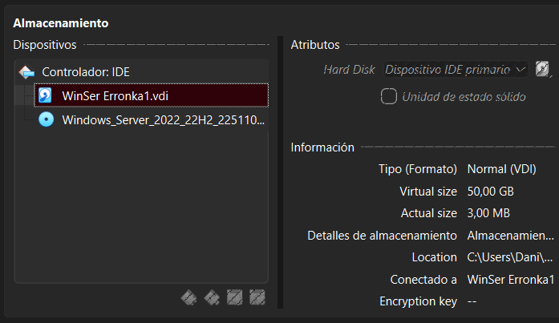
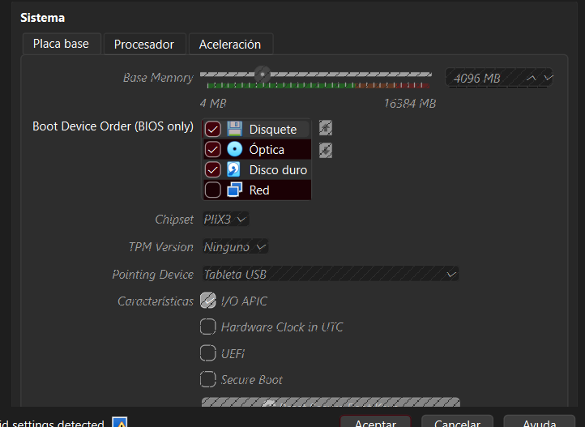

---

## IP-a 

Gure zerbitzarirako, IP finko bat ipini dugu, gure lehen IP-a 192.168.1.20 izango da, hurrengoa +50, hau da, 192.168.1.70. DNS moduz, 127.0.0.1 ipini dugu gure zerbitzarira apuntatzen.

---

## ERABILTZAILE ETA BAIMENAK

Windows barruan, SIstema eragileen osagaiak sortu ditugu, hauek dira: Baimenak, karpetak, erabiltzaileak, taldeak, pasahitz politika…

Honen barruan karpeta batzuk sortu ditugu eta baimen espezifikoak erabiltzaile/taldeei eman diegu, gero, pasahitz politikak eta kontu politikak ezarri ditugu ere. Hasteko karpetak hauek sortu ditugu:

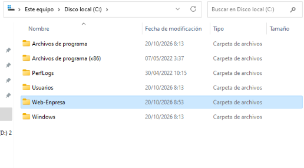
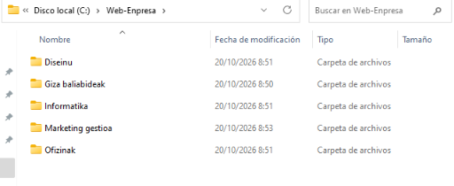

Orain, guztira 10 erabiltzaile sortuko ditugu: 2 Diseinu langileentzat, 1 Giza baliabide, 2 informatika, 3 marketing gestioa eta 2 ofizinak.

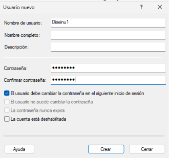

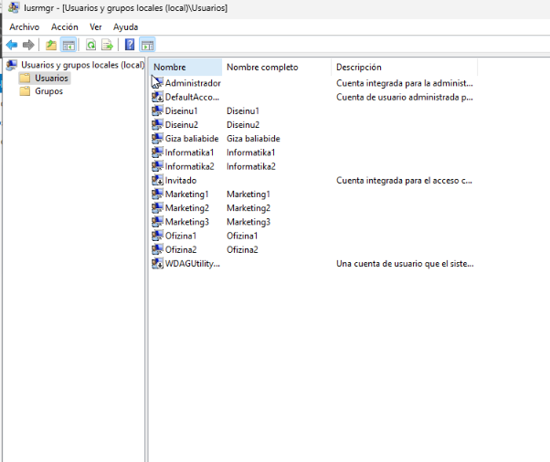

Orain, Erabiltzaile horiek, bakoitza bere taldeetan sartu ditugu, taldeak hauek dira: Diseinu, Giza baliabideak, informatika, marketing eta ofizinak.

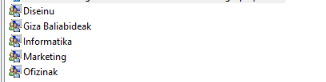

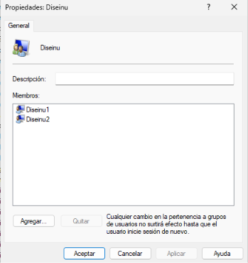

Bakoitzak bere talde barruan daude eta karpeten barruan baimenak eman diegu, baina, herentziak kendu ditugu.

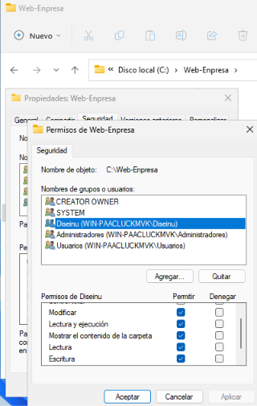

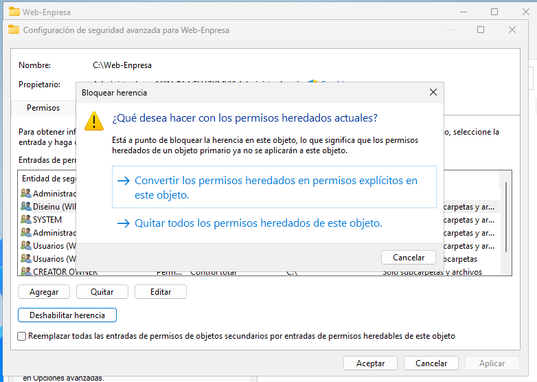

Hona hemen nola gelditu dira, herentziak kendu arren:

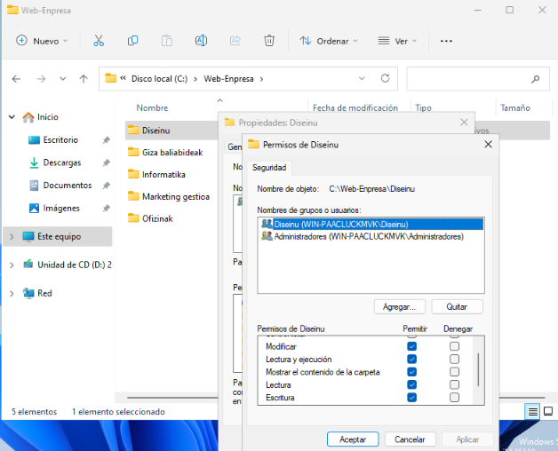
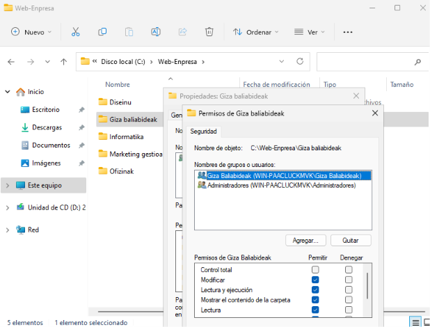
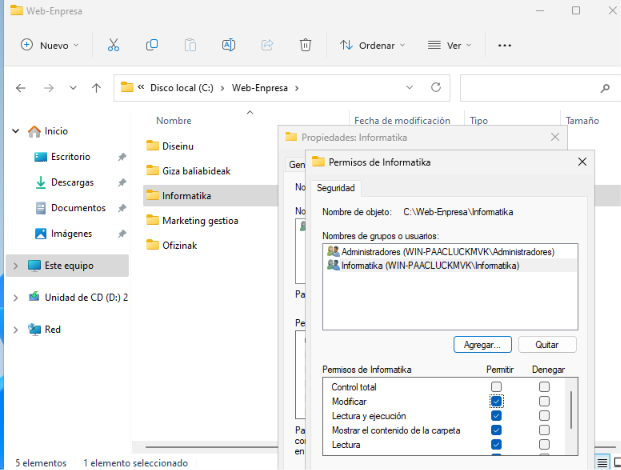
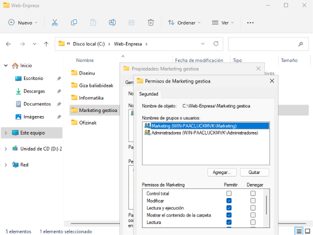
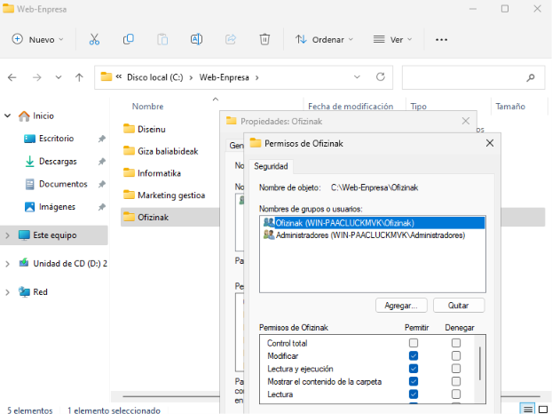

---

#### BAIMENEKIN FROGAK

Froga batzuk diseinu kontuekin egin ditugu. Lehenik sartu gara diseinu1 erabiltzaileekin eta beste karpetetan sartzen probatu dugu.

.png)
.png)

---

## SEGURTASUN POLITIKAK
Pasahitz politikak ezarri ditugu. Honek behar da pasahitzak kontrolatzeko eta segurtasun aldetik hobeto dakartzagu.

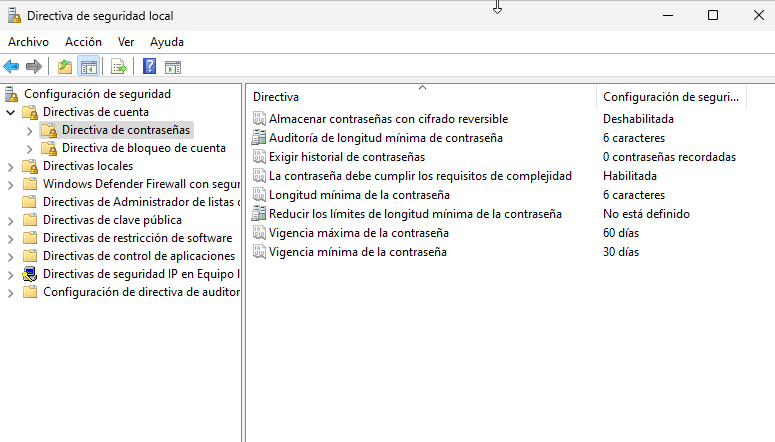
Kontu politikak pasahitz bezalakoa da, baina, murrizketak ezartzen, hau da, logeoak kontrolatu eta pasahitza txarto badago, blokeatu pantaila. Kasu honetan: 

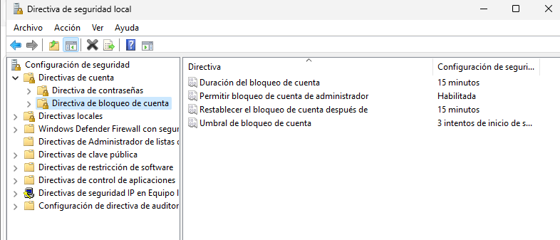

## INSTANTANEA

Hurrengo pausurako, RAID egiturak eta diskoen partizioak egin ditugu. Pausu hauek egin baino lehen, instantanea bat atera dugu, zehozer gertatzen bada gure sistema eragilean, berreskuratzeko gure lehen pausoko lana.

.png)

---

## RAID ETA PARTIZIOAK

RAIDak sortzen hasteko, gure makina birtualean 3 disko gogor sortu ditugu RAID 1 bat egin ahal izateko, lehen diskoak 10GB espazio du, bigarrena tamaina berekoa da espazio diferentziarik ez egoteko, hau da, disko berean bolumen berri solte bat ez egoteko, 3 disko horien barruan segurtasun kopia bat egingo dugu. 

.png)

##### Errore: UnBooteable

Arazo bat izan dugu Windows berriro abiarazterakoan, eta errorea egiaztatu dugu. Disko gogorra IDEtik SATAra aldatzeko orduan (4 disko baino gehiago sartzeko SATA behar dugu) disko gogorra usteldu egiten da, eta hori konpontzeko disko nagusia IDEn eta gehigarriak SATAn utzi ditugu RAID 1 egiteko.

---

## RAID 5

Hori izango litzateke gure RAID 1, 2 disko erabiliz. Horretarako, "bolumen berri islatuari" eman beharko genioke, eta nahi ditugun diskoak hautatuko genituzke; kasu honetan, 1. eta 2. diskoak erabiliko genituzke.

.png)

Hori egitean, RAID 5 bat egitea erabaki genuen, horrela hobeto aprobetxatuko baikenuen sortu ditugun 3 disko gogorren erabilera. Beraz, orain parekotasuna hartu beharko dugu kontuan, hau da, zenbat disko gogor hautsi ahal zaizkigun eta zein diagonalean kalkulatu ahal izateko modu matematikoa, disko gogorren zein datu gal ditzakegun jakiteko. Horretarako, irudi bat jarriko dugu. RAID 5 batekin, RAID 0 eta RAID 1 puntu egongorrak edukiko ditugu (Segurtasuna eta Azkartasuna).

RAID 5a egiterakoan, 3 diskoen 30GBak elkartu zaizkigu, disko bakoitzak 10GBtik 9,98GBra igaro baitira (10GB MBR moduan izango litzateke). Orain 19,91GB erabilgarri ditugu (9,98 paritaterako) eta, beraz, orain RAID 0aren abiadura eta RAID 1aren segurtasuna ditugu.

---

## BABESKOPIAK

RAID 5a egiteari utzi gabe, RAID 5en barruan sortu ditugun Web Enpresa karpetak sartu ditugu, karpeten, fitxategien eta gainerakoen datuak hor barruan edukitzeko.

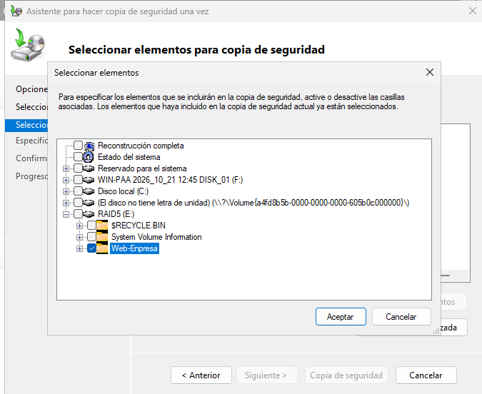

Horren ondoren, RAID 5aren (Web Enpresako Karpetak) segurtasun-kopia bat egin dugu, eta kanpoko disko gogor bat sortu dugu, aurreko beste 3ak bezalakoa, segurtasun-kopia disko lokaletik (Principal) eta beste 3etatik (RAID 5) kanpo egin ahal izateko. 

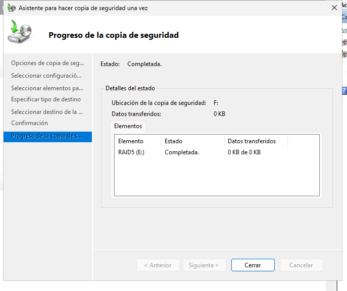

Instalatzeko, "Windowseko babeskopiak" rolak gehitu beharko ditugu, babeskopiak egin ahal izateko. Instalatu ondoren, eta segurtasun-kopien barruan, "segurtasun-kopia bat egin" atalean sartu behar da, "segurtasun-kopia pertsonalizatua" emango dizugu, eta RAID 5en barruan dauden karpetak hautatuko ditugu. Behin instalatzen zaizkizunean, karpeta bat agertuko zaizu, eta, bertan, egindako eta amaitutako segurtasun-kopia aterako zaizu. Beraz, atal hau amaitu egin dugu.

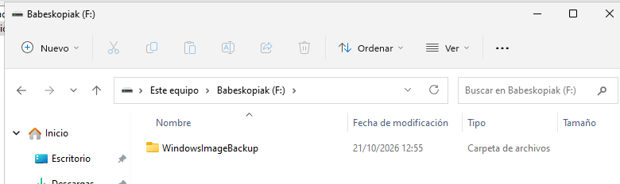

###### Babeskopia programatuta

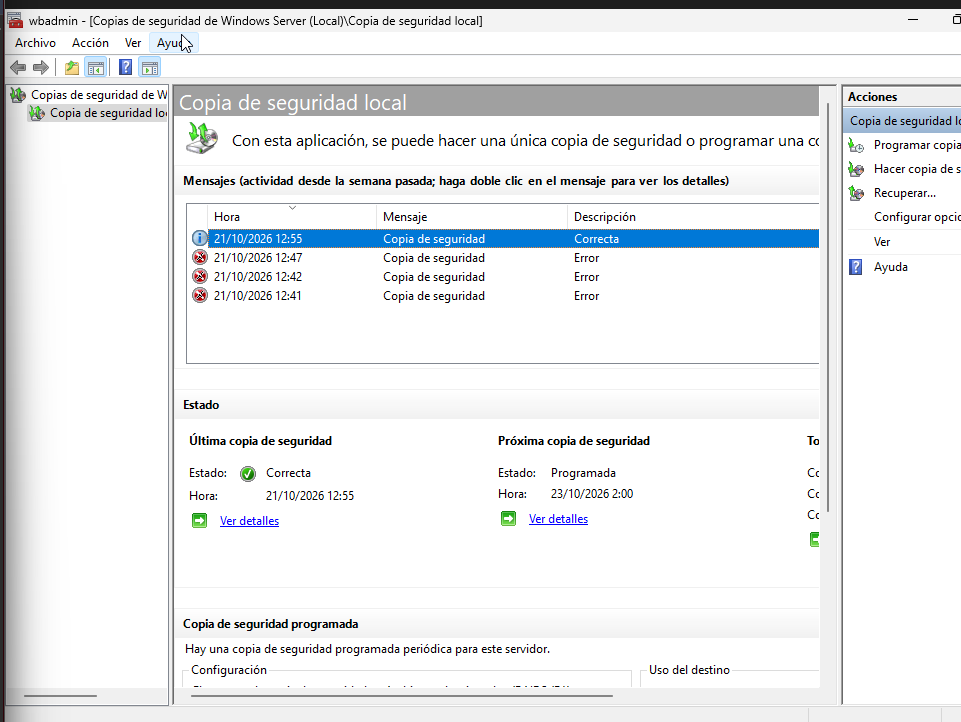

---

## ROLAK

Hurrengoa IIS rola instalatzea da, guztia web-nabigatzailean jartzeko. Windowseko segurtasun-kopiekin egin dugun modu berean egiten dugu hori.

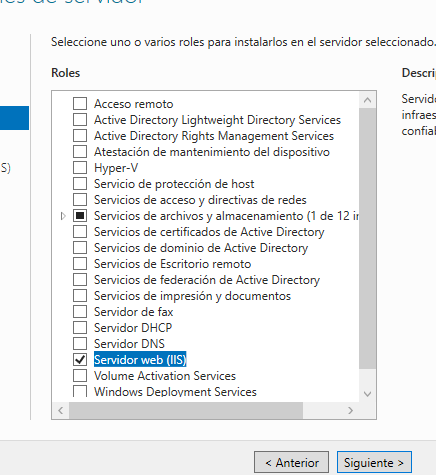
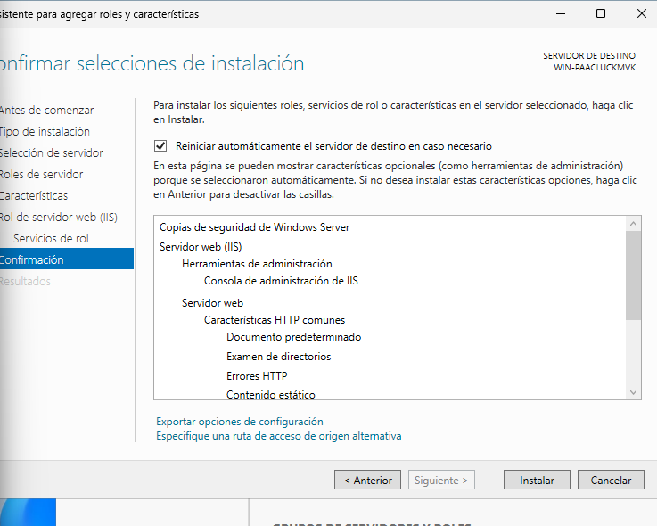
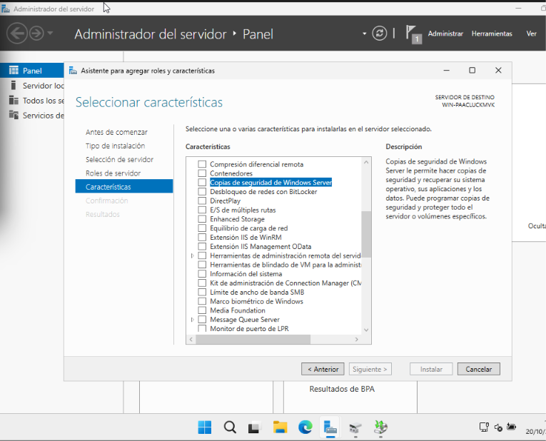
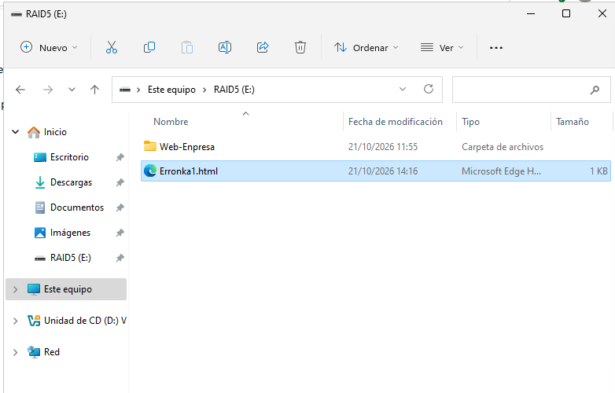

IIS mugikorretik proba egin dugu beste IP batekin eta DHCP bidez.

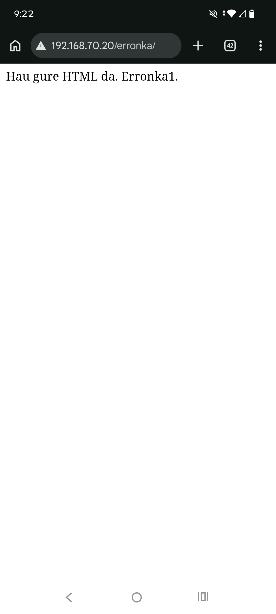

---

## KUOTAK

#### Disko-kuotak

Kuotak 1GBra mugatu ditugu erabiltzaile bakoitzeko, eta 800MB-ko abisua, hasiera batean disko lokalerako bakarrik egin genuen, baina lokalean genuen espazioa ikusita, RAID 5a aldatzea erabaki genuen, eta lehen aipatutako mugak jartzea. Bestalde, 20GBra igo gara erabiltzaileei diskoa mugatzeko eta 18GBri jakinarazteko.

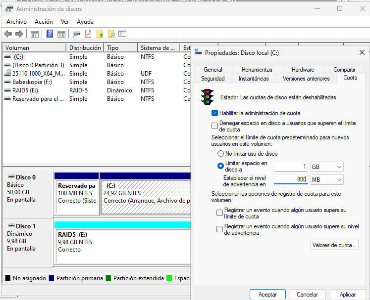
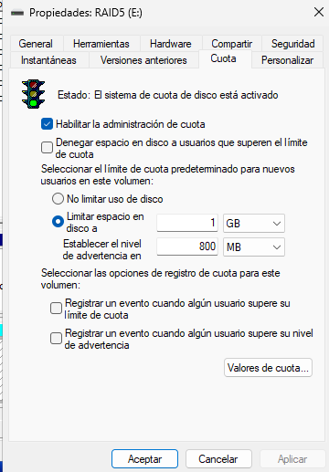
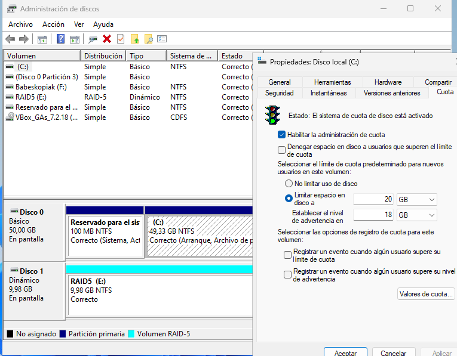

#### Carpeta-kuota

Disko-kuotak alde batera utzita, FSRM karpeten kuotak egin ditugu, eta, beraz, zerbitzariaren rol bat instalatu behar izan dugu: "Fitxategi-zerbitzariaren baliabideen administratzailea (FSRM)". 

Rol hori instalatu behar dugu berariaz karpeten kuotak egin ahal izateko. Instalatu ondoren, Windows+R "fsrm.msc" jarriko dugu, eta zuzenean sartuko gaitu luzapen horretan. "Kuoten administrazioan" sartzen gara "kuotetan", eta gure txantiloia pertsonalizatzen dugu, eta hor ezaugarriak jartzen ditugu, gure kasuan 1GB muga erabiltzaile bakoitzeko, eta %90 Web-Enpresaren karpetara iristen zaie abisua. Muga Web-Enpresaren karpetan jarri dugu, orokorra delako eta hor elkartzen direlako fitxategi gehien.

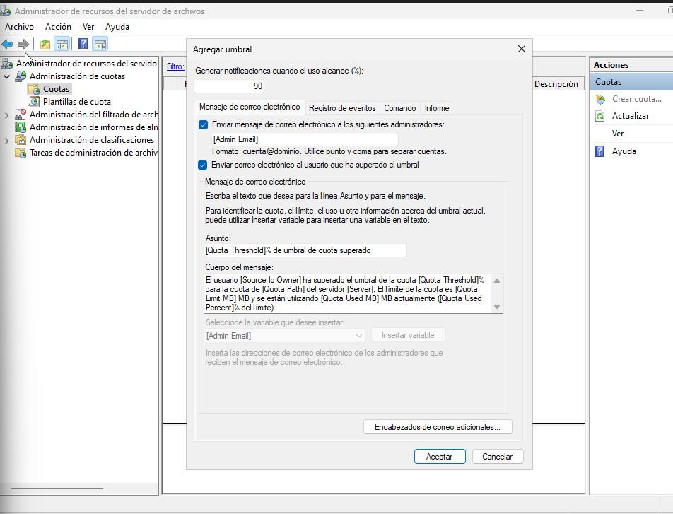
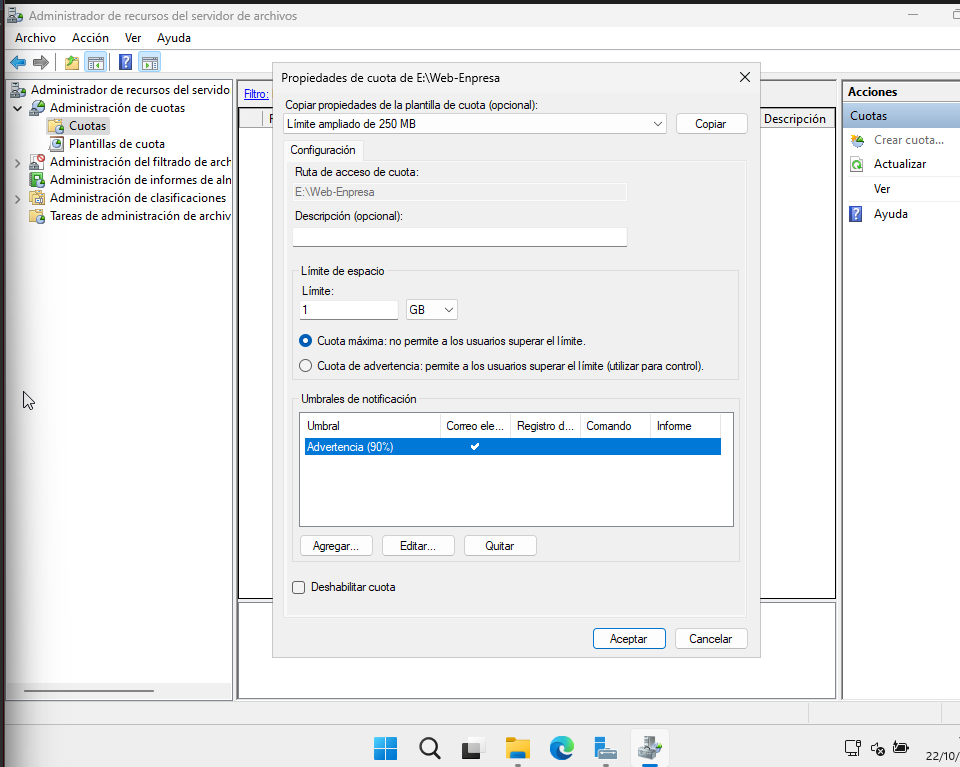
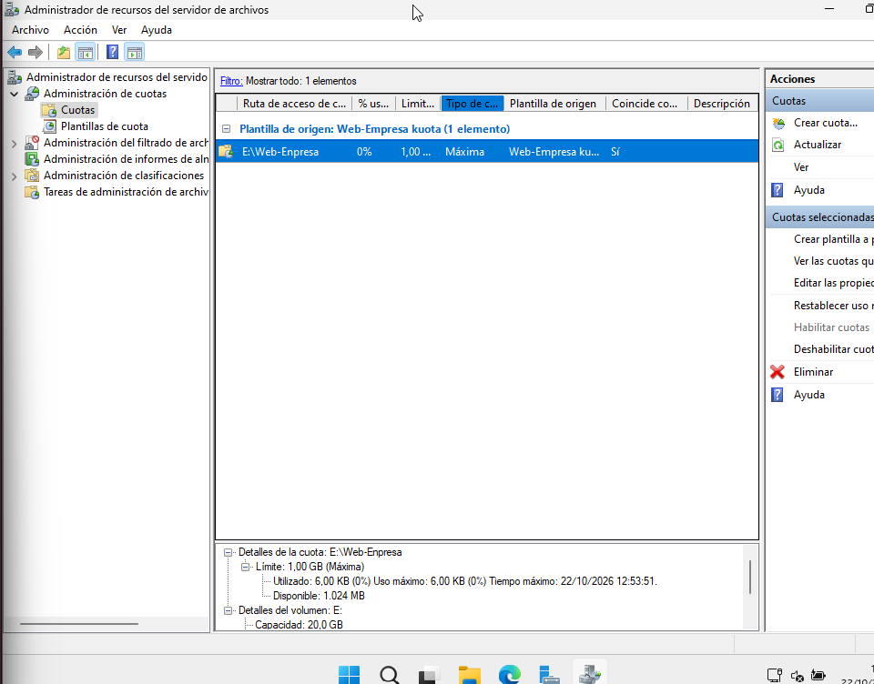

